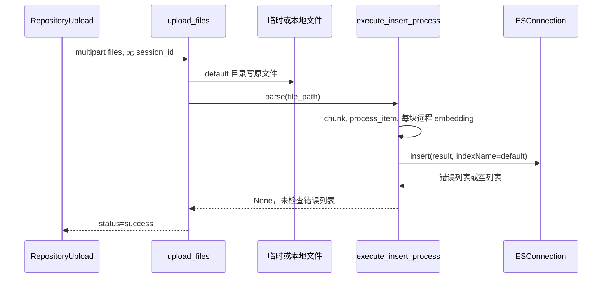

# rag · 核心代码调用链

审查日期：2026-10-13（Asia/Shanghai）。项目：`NicholasZhao-zhenglin/rag`；总仓库 `37ac973e4580442542853bb241e3286caa90dfc3`，后端 `3c4cd2ac1f11c862e31f423054cbef7b3960c7b8`，前端 `56fe6519426174e1b6d8f421bdbeb92e742cc4a4`。下文源码路径均相对于 rag 根目录。审查和隔离验证已执行；业务修复与路线图均未实施。

阅读顺序：[01 系统架构分析](01-system-architecture.md) → [02 核心代码调用链](02-core-call-chains.md) → [03 工程问题清单](03-engineering-findings.md) → [04 优化路线图](04-optimization-roadmap.md) → [05 工程知识学习手册](05-engineering-handbook.md) → [06 面试问答手册](06-interview-questions.md)。

## 链路一：启动与页面准入

`start_frontend.sh` → `npm run dev` → `vite.config.ts` 加载 VITE 配置并启用 proxy（mock 插件明确关闭）→ `src/main.tsx` → 路由 Layout → `AuthGuard`。helper 将未声明 auth 的业务路由默认设为 true；无浏览器 token 时跳 `/login`。Login 页面调用 `api.user.login`，但后端没有相应路由，因此正常新浏览器不能完成这个准入链。已有 token 只会绕过页面检查，不代表服务端已验证身份（F01、F04）。

后端 `app_main.py` → `include_router(chat_rt.router)`，只有三个业务路由。导入过程会触及分词资源、tokenizer 与全局 ES 客户端。根启动脚本用 shell 从 .env 导出变量，Compose 用 env_file，两者不是统一的 Settings 校验入口。没有 readiness 路由或启动资源自检报告。

## 链路二：上传、解析、向量化、索引

入口：`frontend/src/pages/repository/components/upload.tsx::submit`。它按队列串行上传、跳过 status=done 的项、客户端限制每个文件 5 MiB；`api.session.upload` 创建 FormData，只追加 files，没有 session_id。

箭头是程序调用顺序，不意味着磁盘与 ES 原子提交。后端先创建目录，在 try 内以 wb 写原文件，`await file.read()` 一次取全文件，再同步执行解析。没有服务端大小配额、文件名规范化或所属用户判断。P03 在临时目录中复现 session_id 与文件名越过预期子目录；没有触碰真实目录（F04）。

`file_parse.parse` → `naive.chunk`：默认 128 token 配置，PDF 走 OCR/布局/表格分析，DOCX 解析段落表格，TXT 与 Markdown 有路径读取；XLSX/JSON 分支把 binary=None 传给要求数据的下游，实际上传链只传路径，P06 验证有效合成文件仍失败（F07）。`naive_merge` 检查的是已有 chunk 长度，不能将 128 解释成所有输出的硬上限。

`process_item` 串行调用嵌入，构造 q_1024_vec、doc_id、kb_id、分词与时间字段。失败时它返回 None，列表未过滤，后续可能在 ES insert 断言处失败。不同文件相同内容产生相同 _id（F08）。

| 阶段 | 已写入状态 | 失败后用户可见状态 |
| --- | --- | --- |
| 文件已保存 | 原文件可能覆盖同名旧文件 | 后续失败不删除或回滚原文件 |
| 多块嵌入中 | 前面已产生远程调用 | 没有断点续跑或取消后清理 |
| bulk 返回 item 错误 | 可能部分块成功 | 错误列表被忽略，仍报 success（P04） |
| bulk 非超时异常 | 实际写入未知 | insert 清空 res，重复后可能返回空错误列表（P07） |
| bulk 成功但未 refresh | 索引写入与搜索可见分离 | 无 ready 状态；未实测搜索延迟 |

上传没有后台任务 ID、进度存储、事务或回滚。ES insert 内两次循环是局部重试，不构成整个上传用例的恢复保证。

## 链路三：创建聊天与检索

`frontend/src/pages/index/index.tsx::send` → `api.session.create` → POST create_session → UUID 截断成 16 位十六进制字符串 → 前端 sessionActions.add（内存）→ PageTransport 保存第一条 message → `/chat/:id` 页面 useMount 调用 send。

`send` 创建 user 与 assistant 两条消息 → `sendChat` → `api.session.chat` 用 fetch adapter 请求流，并把路由 id 放入 query 的 session_id。后端 `chat_on_docs` 验证 ChatRequest 后，直接同步 `retrieve_content(session_id, question)`。这里没有读取历史消息，传给模型的只有当前拼好的 prompt。

检索链：`retrieval.py::retrieve_content` → 全局 `Dealer.retrieval` → `search` → `FulltextQueryer.question` 构造文本条件 → `model.generate_embedding` 生成查询向量 → `ESConnection.search` 构造全文、knn、融合表达式。默认召回候选 size=max(5×3,128)=128，topk=1024；不是“仅在 ES 查五条”。空结果时再降低 min_match 并调整向量阈值，随后默认第一阶段候选走远程 rerank，再取 page_size=5。

上传索引 default 与这个随机 session 索引不一致（F02/P02）。即使创建了 session，也没有复制文档、别名或知识库关联；不能假定新 session 自动拥有已上传文档。索引不存在时是否报特定 ES 异常依赖真实客户端，本轮仅确认读写命名空间不同。

默认 kb_ids=None，ES 条件构造跳过空值，主要边界依赖调用者给出的 indexNames。调用者可以直接给字符串，代码还允许逗号拆分；没有服务器授权映射。需要把“筛选索引”与“有权读取索引”分开理解（F04）。

`model.rerank_similarity` 从返回节点中只保留 score；`Dealer.rerank_by_model` 则沿原始候选顺序混合 token 分数。若供应商适配器返回已排序节点，会错配分数和原 chunk。P08 用换序 fake 证明条件风险，实际自定义 rerank 包版本与返回顺序未安装验证，列入待确认 Q01，不冒充线上错排。

## 链路四：模型输出与 SSE 消费

`chat_on_docs` 把编号引用拼入 prompt → 返回 StreamingResponse → 同步生成器 `chat.get_chat_completion` 调用 deepseek-r1。创建流成功后先发 documents，再逐块发送 content/thinking；finish_reason=stop 时同步调用第二个模型生成推荐问题，之后发 `[DONE]`。因此最后一段回答到 end 之间还可能等待推荐请求。

已有保证：用 JSON 编码正文；生成器捕获异常并发 event:error。缺口：检索在生成器之前，检索异常不走流内 error；生成器 error 没有统一终态事件；只有 stop 分支发送 end，其他结束原因与自然 EOF 没有同等语义；没有显式应用级总时间预算或持久化重放游标。SDK 的默认重试/超时不等于本项目定义的产品预算。

前端 `read` 累积网络字节解码结果、按换行分割，只处理 data 行；`parseData` 忽略 event 与 role，只要 content 非空就追加到答案。P09 验证后端 role:error 被展示成回答而没有设置 target.error（F10）。`[DONE]` 只被跳过，loading 最终靠 EOF/finally 清理。useUnmount 仅重置 device chatting，没有绑定 reader.cancel 或请求中止；重复请求插件的取消能力不等价于页面卸载释放流。

前端 TextDecoder 未用流式 decode 选项，若收到原始 UTF-8 多字节跨包会有风险；当前 Python json.dumps 默认转义非 ASCII，因此不把这项扩大为当前中文回答必然乱码。

`ChatMessage`、引用 Drawer → `components/markdown/index.tsx` → Marked → dangerouslySetInnerHTML。P10 证明当前锁定 Marked 保留合成事件属性，组件没有清洗，因此从模型或文档来的 HTML 是信任边界（F09）。未在真实浏览器执行脚本或访问用户存储。

## 链路五：刷新与伪完整状态

没有 PageTransport 首条消息时，聊天页调用 `/get_messages/`；导航页读取 `/get_sessions/`。两者在本后端均为 404（P01）。`repository/index.tsx` 的 useRequest 返回两条硬编码示例，refresh 只是重新返回示例；设置、删除等按钮没有真实处理链。

`assistant.py`、`session.py`、`retrieval2.py`、`service/chat_with_doc.py` 是遗留/备选函数，未被默认 app/router 链调用；不能借它们的函数名认定主路径具有持久化或完整 RAGFlow 服务能力。
