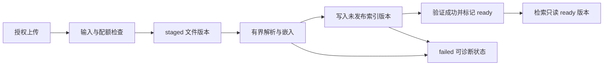

# rag · 优化路线图

审查日期：2026-10-13（Asia/Shanghai）。项目：`NicholasZhao-zhenglin/rag`；总仓库 `37ac973e4580442542853bb241e3286caa90dfc3`，后端 `3c4cd2ac1f11c862e31f423054cbef7b3960c7b8`，前端 `56fe6519426174e1b6d8f421bdbeb92e742cc4a4`。下文完整源码路径相对于 rag 根目录；短路径承接已给出的完整定位：后端入口/路由位于 `backend/app/`，解析、检索、模型及 `rag/`、`deepdoc/` 位于 `backend/app/service/ragflow/`，前端模块位于 `frontend/src/`。审查和隔离验证已执行；业务修复与路线图均未实施。

阅读顺序：[01 系统架构分析](01-system-architecture.md) → [02 核心代码调用链](02-core-call-chains.md) → [03 工程问题清单](03-engineering-findings.md) → [04 优化路线图](04-optimization-roadmap.md) → [05 工程知识学习手册](05-engineering-handbook.md) → [06 面试问答手册](06-interview-questions.md)。

## 目标与排序依据

以下全部是**建议实施**，本轮仅完成审查与离线验证。当前最重要的目标是让一个授权用户完成“进入页面→上传文档→基于正确集合回答→失败可见”的闭环，再讨论吞吐量。没有真实负载与检索质量基线，不给出提升倍数、并发人数或固定工期。

| 阶段 | 具体交付 | 对应问题 | 前置依赖 | 可观察退出条件 |
| --- | --- | --- | --- | --- |
| A：建立信任与输入边界 | 清除凭据 fallback、服务器身份/知识库授权、路径约束、Markdown 清洗 | F03/F04/F09 | 确定单用户还是多用户产品边界 | 未授权/越界输入无副作用，合成 HTML 不执行，配置缺失 fail fast |
| B：打通最小使用链 | 定义会话与知识库 ID、实现准入及历史契约或明确精简 UI、统一上传解析输入 | F01/F02/F07 | A 的身份与数据归属 | 干净浏览器完成上传问答；刷新/不支持功能有明确行为 |
| C：让状态可信 | bulk 错误结构、文件版本/chunk 身份、索引 ready 发布、SSE 终态与取消 | F05/F08/F10 | B 的 ID 与接口契约 | 故障不报成功、旧版本可继续读取、流错误不冒充正文 |
| D：可复现与有界执行 | peer 依赖、lint、运行资源清单、统一配置、上传配额、有界执行器 | F06/F11/F12 | A–C 的回归用例 | 默认安装/构建/检查通过；慢任务不无界占用；部署拓扑实测 |
| E：质量与规模演进 | 带标注语料评测、重排顺序契约测试，再决定队列与 worker | Q01 与产品目标 | 可靠闭环与测量系统 | 指标可重复，能解释错误归因；升级由瓶颈触发 |

A 与默认安装整理可以并行推进，但先修某个 npm 报错不能替代后端闭环。每阶段应是可独立评审的小变更，不把所有问题捆绑为框架重写。

## 建议接口与状态模型（未实施）

将 conversation_id 表示会话、knowledge_base_id 表示资料集合、document_id 表示文件逻辑身份、version 表示一次发布、job_id 表示处理执行。服务端从授权上下文决定存储边界，浏览器不直接决定 ES 索引表达式。小型单用户部署可以先用简单持久化实现，不能因此跳过状态契约。

这是建议的数据发布顺序，不是当前代码已有队列。可先同步执行 W，但所有失败仍需留下可靠的状态；若引入后台 worker，任务状态与重复执行幂等性先于队列技术选型。

建议 SSE 事件携带 request_id、type、payload 和终态；error 是业务事件，不等于追加一段回答。客户端离开页面应主动取消传输，服务器再按 SDK 能力关闭流；记录哪些边界只能停止本地消费，不能保证供应商立即停止生成。

## 关键决策与取舍

| 决策 | 保留现状的代价 | 最小可行改造 | 进一步升级的触发信号 |
| --- | --- | --- | --- |
| 同步解析还是任务队列 | worker 被长任务占用，失败不可追踪 | 有界线程/进程执行器与 job 状态 | 长任务显著超过请求预算，需要重启恢复或跨机扩容 |
| session 对应 ES 索引 | 文档集合与对话生命周期耦合，索引数量增长 | 显式知识库 ID 与服务端归属映射 | 测得分片开销后比较共享索引+严格过滤；不预先强制迁移 |
| chunk 内容去重 | 丢失多文档来源 | doc/version/chunk ordinal 作为写入 ID | 重复存储成为真实成本后再引入内容实体与归属关联 |
| 上传成功定义 | bulk 调用结束不等于可检索 | 检查失败项、刷新/可见性策略与 ready 状态 | 大批量下测量 refresh 成本，再设计批次发布 |
| 认证产品还是内部演示 | UI 与 API 能力不一致 | 明确契约；不可用功能显式隐藏或实现 | 多用户共享资料时必须做服务端授权与审计 |
| 模型与检索配置 | 硬编码难复现、缺总预算 | 一个配置对象与 typed gateway | 多供应商差异真实出现后再增适配器 |

## 迁移与回退

F02/F08 涉及标识和存量索引。先记录旧 session/index 与文件清单，仅对可确认归属的数据建立映射；无会话表的旧数据不能猜测所有者。新 schema 写入新版本或新命名空间，离线比对文件数、chunk 数、内容摘要与引用归属；通过后切读，旧索引保留到确认回滚窗口结束。不要就地删旧块后再做高风险重建。

接口变更可暂时接受旧字段，但由服务器解析为明确的知识库关系并告警；禁止“兼容模式”重新开放任意索引选择。回退应能切回旧发布指针并暂停新写入；凭据轮换与撤销旧凭据不能当作可随意回退的状态，旧秘密不得恢复到源码。

## 需要测量什么

| 指标 | 测量位置 | 如何确定目标 |
| --- | --- | --- |
| 文档可见成功率、失败原因 | upload/job 状态与 ES 验证 | 以合成 fixture 完全正确为门槛，再测真实格式 |
| 首帧与完成延迟 | 请求、检索、答案流、推荐请求分别打点 | 按交互预算设分位数目标，不拿构建时间当响应速度 |
| 峰值内存、活动任务、排队时间 | 有界执行器与 worker | 从最大允许文件/页数和机器预算推导 |
| 命中、引用准确率、拒答率 | 标注问题/文档集 | 冻结语料与模型版本，人工判定少量困难样本 |
| 超时与取消后的活跃请求 | gateway 与客户端流 | 假网关可观察资源关闭；真实 SDK 再做授权集成 |
| 文档重传幂等性 | 同一 document/version 重试 | chunk/归属不重复，旧版本不混入 |

## 验证矩阵与推广

先把本轮缺陷探针转为期望正确行为的回归：P01/P02 验证契约与资料集合，P03 验证根内路径与授权，P04/P07 注入部分失败/不可用，P05 检查文档归属，P06 走完整格式入口，P09/P10 检查流与 HTML 边界。P08 加上真实适配器固定版本的节点身份顺序测试后才关闭 Q01。

下一层是独立临时 ES 的集成，测试 bulk 部分失败与 refresh 可见性；再是使用合成文档、受控模型假服务的浏览器端到端。最后才运行真实模型与部署检查，明确预算、资源与数据范围。生产压测不是本轮检查的隐含授权。

问题关闭必须记录修复提交、回归命令、环境和失败路径结果，更新 03 状态、01/02 当前行为与根目录交接文件。不要用“探针仍然复现旧 bug”作为修复验收，也不要把方案写成已上线成果。
