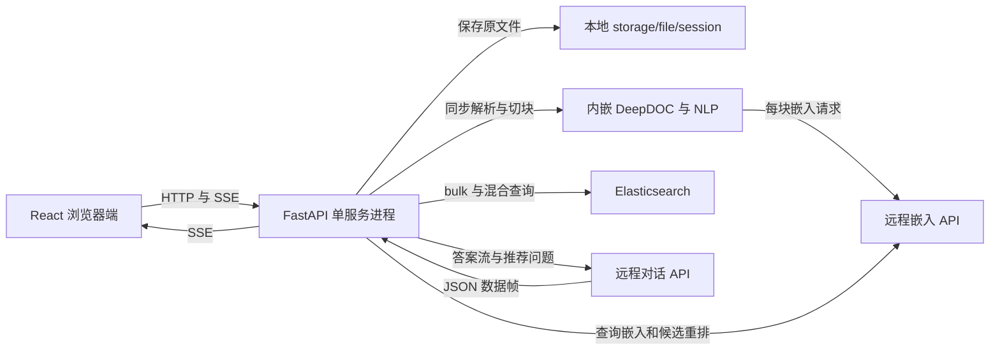

# rag · 系统架构分析

审查日期：2026-10-13（Asia/Shanghai）。项目：`NicholasZhao-zhenglin/rag`；总仓库 `37ac973e4580442542853bb241e3286caa90dfc3`，后端 `3c4cd2ac1f11c862e31f423054cbef7b3960c7b8`，前端 `56fe6519426174e1b6d8f421bdbeb92e742cc4a4`。下文源码路径均相对于 rag 根目录。审查和隔离验证已执行；业务修复与路线图均未实施。

阅读顺序：[01 系统架构分析](01-system-architecture.md) → [02 核心代码调用链](02-core-call-chains.md) → [03 工程问题清单](03-engineering-findings.md) → [04 优化路线图](04-optimization-roadmap.md) → [05 工程知识学习手册](05-engineering-handbook.md) → [06 面试问答手册](06-interview-questions.md)。

## 架构判断

这是通过 Git 子模块组合的文档问答原型：React 浏览器端调用 FastAPI；后端在同一个服务进程内解析文档、调用远程嵌入与重排服务、访问 Elasticsearch，再流式调用对话模型。它没有独立任务 worker、持久会话服务或已接线的后端身份体系。当前锁定的前后端版本存在接口与知识库标识错配，不能把页面齐全或构建成功解释为完整产品可用。

证据入口是 `.gitmodules`、`backend/app/app_main.py::app`、`backend/app/router/chat_rt.py`、`frontend/src/api/session.ts` 与 `frontend/src/router/routes.tsx`。模型相关名称来自当前调用实参，不代表这些服务本轮已被调用。

## 基线、获取方式与覆盖

总仓库 main 克隆后初始工作区干净。Git 子模块下载因网络停顿未完成，改从 GitHub 已认证 API 下载**固定提交** tarball，解压到 backend、frontend；因此本地内容是锁定版本源码快照，不宣称子模块 Git 初始化成功。本轮没有读取 `.env` 的值，没有解析根目录业务 PDF，没有运行模型下载入口。

| 范围 | 阅读深度 | 实际验证 | 未覆盖 |
| --- | --- | --- | --- |
| 总仓库、依赖、启动与 Compose | 全部关键配置；排除 IDE 私有状态 | shell 语法检查、版本及文件定位 | Docker 构建、基镜像可用性、生产网络 |
| API、入库、检索、流式生成 | 逐函数追踪默认链 | AST 提取真实函数的离线 TestClient 与适配器探针 | 应用完整 import、真实 ES/模型 |
| React 路由、上传、聊天、状态、Markdown | 核心页面和请求插件深入阅读 | 锁文件安装诊断、构建、lint、解析函数探针 | 浏览器业务端到端与登录成功 |
| 内嵌 DeepDOC、NLP | 60 个 Python 文件结构与语法覆盖；深入解析入口、分词资源、查询与 ES 实现 | XLSX/JSON 适配边界 | OCR 数学细节、表格模型精度、全部格式样本 |
| 其他工具与演示 | 浏览符号与调用关系 | 无 | 未接线 RAGFlow HTTP 适配器、简历解析、视觉 demo 运行 |

实际结果：60 个 Python 文件语法解析通过；8 项后端探针完成，其中 7 项复现确定行为，P08 仅演示重排适配器返回换序结果时的条件风险；2 项前端函数探针完成。默认 `npm ci` 因 React 19 与 ahooks peer 范围冲突失败；仅在隔离副本使用 `--legacy-peer-deps` 后安装与 `npm run build` 成功；`npm run lint` 为 26 errors、10 warnings。这些不是生产测试通过数。详细机制与探针编号见 03。

## 当前运行与数据流

下图箭头表示调用或读写，不表示事务、异步队列或部署已成功。

Compose 声明 API 容器与 ES 8.11.3，ES 使用命名卷；模型是远程服务，DeepDOC 缺失权重时还可能在本机下载模型。Nginx 配置和 Dockerfile 单独存在，但没有列入该 Compose 服务。不能把 Nginx、前端静态站与 API 画成已上线的同一部署。`start_backend.sh` 监听主机 8001；Compose 是主机 8001 → 容器 8000；独立 Nginx 配置指向主机 8000，组合部署需要校准。

## 模块为什么存在

| 模块与源码 | 职责和主要依赖 | 拥有的状态 | 交付与边界 |
| --- | --- | --- | --- |
| `frontend/src/router` 与 `store/user.ts` | 依据浏览器 token 控制路由；依赖 React Router、Valtio | token 与用户名持久化 | 是页面导航检查，不能替代服务端鉴权 |
| `frontend/src/api/request` | Axios 统一响应、loading、错误提示、重复请求取消 | 模块级请求 Map | HTTP 层成功不等于 SSE 业务成功 |
| `frontend/src/pages/repository` | 选择文件、串行上传、显示文件表 | 上传列表与静态示例表 | 5 MiB/10 文件是 UI 限制；没有真实列表接口 |
| `frontend/src/pages/chat` | 管理当前消息、消费流、展示引用 | 当前页面内存消息与引用 | 页面刷新依赖未实现的历史接口 |
| `backend/app/router/chat_rt.py` | 三个 HTTP 用例；依赖 Pydantic、入库、检索、生成函数 | 不持久化 session 元数据 | 直接驱动同步业务代码 |
| `file_parse.py` 与 `rag/app/naive.py` | 格式解析、切块、生成向量和标识 | 原文件、临时解析对象 | 默认 PDF 走 DeepDOC；不等于完整 RAGFlow 服务 |
| `rag/nlp/search_v2.py::Dealer` | 文本与向量召回、候选重排、top 5 返回 | 请求内候选、分数数组 | 默认链即使 embd_mdl=None 仍调用嵌入与重排 |
| `rag/utils/es_conn.py::ESConnection` | ES DSL、bulk、有限重试 | 进程内 singleton 客户端；加载 mapping | 没有跨文件事务、任务状态或回滚 |
| `chat.py` | 答案流、引用、推荐问题 | 生成器局部状态 | 不保存历史；session_id 没有用于模型会话状态 |

## 数据事实源与一致性

原文件由 `upload_files` 写入 `storage/file/<session_id>/<filename>`，它是文件事实源，但没有版本或 manifest。chunk 文本、分词、向量进入以 session_id 命名的 ES 索引，是检索事实源。浏览器引用卡片是响应的派生状态；仓库页的示例行不是 ES 的镜像。

`process_item` 的 chunk ID 是内容与 session_id 的 xxhash，doc ID 是文件名的 xxhash。不同文件的相同段落会共用 chunk ID；同名文件重复上传覆盖原文件，却没有清理旧 chunk 的版本发布过程。ES bulk 使用 index 操作与 `refresh=False`；上传成功不保证检索立即可见，也没有应用层可查询的 ready 状态。F05、F08 分别讨论错误传播和文档身份。

会话创建只是生成随机 ID 并返回。没有会话表、消息表、数据库迁移、用户与索引归属映射。浏览器 token 持久化与服务端用户状态并不等价，UUID 随机性也不构成授权。

## HTTP 与信任边界

| 实际路由 | 输入 | 输出 | 主要边界 |
| --- | --- | --- | --- |
| POST `/create_session` | 无 | session_id/status/message | 没有持久化或鉴权 |
| POST `/upload_files/` | multipart files；query session_id 可省略 | success 或 HTTP 500 | 未校验路径、类型大小上限；错误列表可被忽略 |
| POST `/chat_on_docs/` | message 字符串；query session_id | SSE documents/content/thinking/recommended_questions/end/error | 检索在发送流之前；错误帧需客户端识别 |

不存在当前前端要求的 `/login`、`/register`、`/get_sessions/`、`/get_messages/`。README 的 path session_id 示例也不等于当前 query 参数协议。

## 依赖、初始化与执行上下文

后端固定 FastAPI 0.115.0、Uvicorn 0.31.0 等部分依赖，但 OpenAI、Elasticsearch、NLP 和解析包大多无版本约束，也没有完整锁文件。Dockerfile 依赖自定义 `gsk_poc_base:0.0.1`，其构建来源未包含在仓库。分词资源目录、NLTK 数据与模型缓存需要外部准备。

`app_main` 导入 router，router 导入 file_parse/retrieval，再构造全局 ESConnection 和 Dealer；这些导入发生在 router 本地 `load_dotenv()` 之前，其他模块也有 dotenv 加载，配置时序不统一。ES 地址及凭据来源另有硬编码；读取 mapping 不等于创建索引或应用 mapping。本轮没有验证实际客户端兼容性。

前端锁文件核实 React 19.0.0、Vite 6.1.0、TypeScript 5.7.3、Marked 15.0.7、Axios 1.7.9。验证运行时 Python 3.11.9、Node 24.21.0；它们是本轮环境，不是项目已声明支持矩阵。

上传的同步解析/嵌入与聊天的同步检索在 async 路由内直接调用；并没有自动迁移到任务 worker。StreamingResponse 对同步生成器的消费是另一个边界，本轮安装的 Starlette 0.38.6 用线程池迭代器适配同步迭代；不应把生成流与之前的检索一概称为事件循环阻塞。此语义同时核对本地依赖源码与 [FastAPI 官方说明](https://fastapi.tiangolo.com/async/)。

## 值得保留的设计

三仓提交锁定提供可追溯基线；路由与解析/检索/生成文件的分离便于替换外部边界；Pydantic 检查 message 基本类型；SSE 用 `json.dumps` 构造数据而非手工拼接；前端消息 loading 在 finally 中释放，能避免常规请求异常后一直转圈。ES bulk 保留按项错误的结构、上传 UI 保留逐文件状态，都可成为修复的落点。它们的保障只覆盖对应局部路径，不能掩盖当前契约问题。
